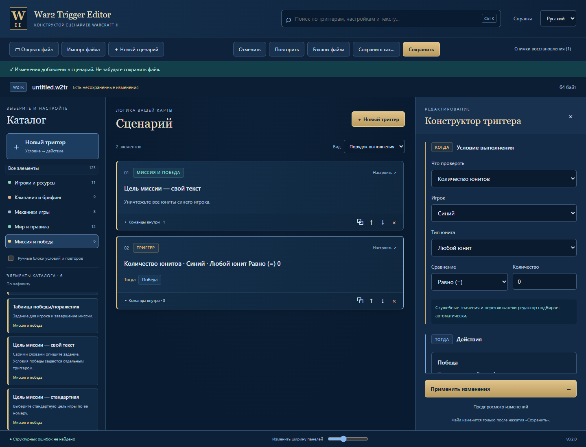

# War2 Trigger Editor

Тестовая Windows-сборка современного редактора триггеров War2Combat.
Rust + React/TypeScript, отдельные крейты, единый локальный API.
Это кандидат для проверки, не релиз с подтверждённой игровой совместимостью.

## Запуск

[Скачать тестовую сборку для Windows x64](https://github.com/AyakaNyaa/War2TriggerEditor/releases/tag/v0.2.0-preview.1).
Скачайте **War2TriggerEditor-preview.zip**, распакуйте и запустите **War2TriggerEditor.exe**.
[Пошаговая инструкция запуска](docs/RUN_RU.md).

После самостоятельной сборки EXE находится в `target/debug/war2-editor.exe`.

Интерфейс встроен в EXE; отдельный Node.js или сервер для запуска не нужен.
Windows должен иметь WebView2 Runtime. Интернет для редактирования не требуется.
Программа поднимает API только на 127.0.0.1, на свободном порту, и открывает окно.

[Пояснение переключателей](docs/images/switch-guide.png) ·
[Выбор игроков вместо числовых флагов](docs/images/player-selection.png)

## Уже реализовано

- Чтение всех 4 PUD и 10 W2TR из исходного пакета.
- Побайтное сохранение файла без изменений; точечная запись изменённых команд.
- Сохранение неизвестных секций, порядка, хвостов и исходных записей имён.
- Оба окончания байткода: FE FF и FE ED.
- Формы свойств, создание команд, дублирование, перемещение, удаление.
- Визуальный конструктор «Когда → Тогда», настройка перед добавлением.
- Условия количества юнитов и ресурсов, несколько действий в одном триггере.
- Отдельная настройка текста задания и триггеров победы/поражения.
- 13 групп из исходного редактора, сквозной поиск и алфавитный каталог.
- Группировка сценария без изменения игрового порядка, вложенные блоки.
- Переключатели с пояснениями; выбор игроков по названиям вместо битовых чисел.
- Необязательный предпросмотр изменений, undo/redo.
- Русский/английский интерфейс и изменение ширины панели.
- Бэкап перед записью, проверка конфликта с внешними изменениями файла.
- Снимок восстановления после каждого применённого изменения.
- Список файловых бэкапов и восстановление с бэкапом текущего файла.
- CLI inspect/validate/roundtrip через тот же API.

Для основных команд есть именованные поля и списки юнитов, игроков и сравнений.
У части продвинутых команд пока показаны числовые аргументы;
полные удобные формы для них ещё требуют доработки и игровой проверки.

## Документы

- [Пользовательская инструкция](docs/USER_GUIDE.md).
- [Скачать и запустить без сборки](docs/RUN_RU.md).
- [Сборка и проверки](docs/DEVELOPMENT.md).
- [Форматы и сохранность](docs/FORMATS.md).
- [Текущее состояние и ограничения](docs/STATUS.md).
- [Семантика исходного редактора и конструктор](docs/BUILDER.md).
- [Согласованный проект](PROJECT_PROPOSAL.md).

Лимит 500 строк проверяется для файлов проекта, включая lock-файлы
и генерируемые схемы. Исходники, тесты, конфигурация и переводы разбиты на модули.
Неизменённый внешний архив и внешние зависимости не являются кодом редактора.
